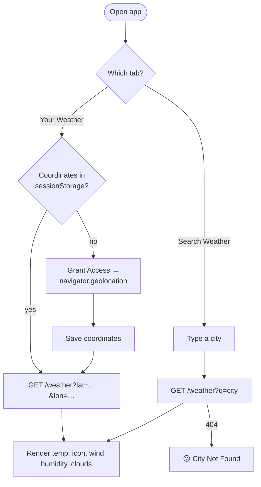

<div align="center">

# 🌦️ Advanced Weather App

**Real-time weather for where you are — or anywhere you search. Temperature, conditions, wind, humidity and cloud cover from the OpenWeatherMap API.**

[](https://advanced-weather-app.vercel.app)


[Features](#-features) · [How it works](#-how-it-works) · [Getting Started](#-getting-started) · [Structure](#-project-structure)

</div>

---

## ✨ Features

| | Feature | Details |
|---|---|---|
| 📍 | **Your Weather** | One-time location permission → weather for your exact coordinates |
| 🔎 | **Search Weather** | Look up any city in the world |
| 🌡️ | **Key readings** | Temperature (°C), description, weather icon and country flag |
| 💨 | **Details** | Wind speed (m/s), humidity (%) and cloudiness (%) |
| ⚡ | **Remembers you** | Coordinates are cached in `sessionStorage`, so switching tabs doesn't re-ask |
| ⏳ | **Loading & error states** | Spinner while fetching, and a "City Not Found" message for unknown cities |
| 📱 | **Responsive** | Works on phones, tablets and desktops |

## 🔄 How it works



## 🚀 Getting Started

1. **Clone the repository**
   ```bash
   git clone https://github.com/Shariq2003/Advanced-Weather-APP.git
   cd Advanced-Weather-APP
   ```
2. **Get a free API key** from [OpenWeatherMap](https://openweathermap.org/api).
3. **Add your key** in `index.js`:
   ```js
   const API_KEY = "your_api_key_here"; // replace with your actual API key
   ```
4. **Open `index.html`** in your browser (or run `npx serve .`).

> 💡 Location access requires HTTPS or `localhost`, so serve the folder locally if "Grant Access" doesn't respond.

## 📁 Project Structure

<details>
<summary><b>Expand tree</b></summary>

```text
Advanced-Weather-APP/
├── index.html    # tabs, grant-access screen, search form, weather card
├── styles.css
├── index.js      # geolocation, API calls, rendering
└── assets/       # icons (wind, humidity, cloud, search…) and loading gif
```

</details>

---

<div align="center">

Built by **[Shariq](https://github.com/Shariq2003)** · [LinkedIn](https://www.linkedin.com/in/shariq-sd)

⭐ If you like this project, consider giving it a star!

</div>
